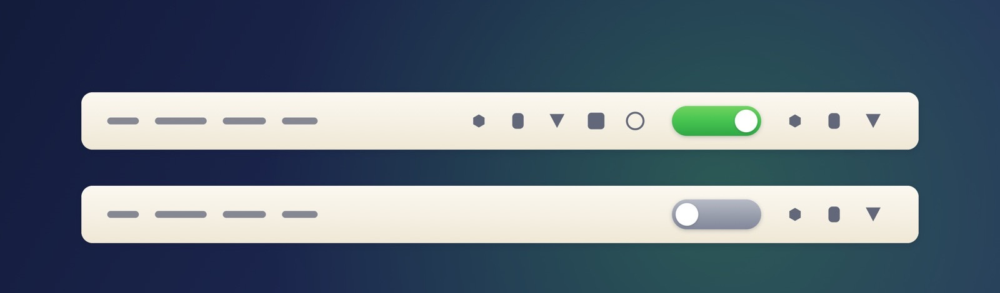

# 留白 · BlankTop

**更优雅的菜单栏开关。** macOS 27 上的菜单栏折叠工具：一个开关，把不常用的图标收起来，需要时再放出来。

<p align="center">
  
</p>

<p align="center">
  <a href="https://github.com/xiaoan223/BlankTop/releases/latest">下载</a> ·
  <a href="https://xiaoan223.github.io/BlankTop/">官网</a> ·
  <a href="#编译">编译</a> ·
  <a href="#原理">原理</a>
</p>

## 它做什么

macOS 27 的菜单栏塞满图标时，你没法只收起来一部分。BlankTop 在菜单栏放一个开关：

- **展开**：圆点在右、底板绿色，菜单栏完整可见
- **折叠**：圆点在左、底板灰色，开关左边的图标全部收起，右边保持可见

决定哪些图标被收起的方式和系统一致：按住 `⌘` 拖动图标到开关左边即可，顺序由 macOS 自己记住。

<p align="center">
  
  
</p>

## 特性

- **并发扫描**：每次折叠都重新读取所有 App 的图标位置，60+ 个 App 并发查询，热态 20–30 ms
- **没有后台服务**：一个 172 KB 的菜单栏进程，无守护进程、无网络请求、无遥测
- **18 种图标样式**：开关、箭头、眼睛、托盘、月亮、压缩……右键菜单里随时切换
- **轻音效**：折叠 `Pop`、展开 `Tink`，音量可调，也可完全关闭
- **全局快捷键**：默认 `⌥⌘H`
- **无第三方依赖**：纯 Swift + 50 行 ObjC 桥接层，Command Line Tools 即可编译

## 安装

1. 从 [Releases](https://github.com/xiaoan223/BlankTop/releases/latest) 下载 `BlankTop-1.0.1.dmg`
2. 拖进 `/Applications`
3. 首次运行授权「辅助功能」（系统设置 → 隐私与安全性 → 辅助功能 → 留白）
4. 按住 `⌘` 把想隐藏的图标拖到开关左边，点开关

> ⚠️ 必须放在 `/Applications`。系统白名单只对这个目录生效，放在别处时折叠连它自己的开关也会被藏掉。

## 配置

`~/Library/Application Support/BlankTop/config.json`（首次运行自动生成）

```json
{
  "hotkey": "opt+cmd+h",
  "autoCollapseSeconds": 0,
  "icon": "toggle",
  "expandMode": "allowlist",
  "sound": "tink",
  "soundVolume": 0.12
}
```

| 键 | 说明 |
|---|---|
| `hotkey` | `opt` / `cmd` / `shift` / `ctrl` 组合，键位支持 a–z、0–9 |
| `autoCollapseSeconds` | 展开后多少秒自动收回，`0` 表示不自动 |
| `icon` | `toggle` `chevron` `chevronThin` `triangle` `toLine` `symbol` `eye` `dot` `bar` `sidebar` `tray` `archive` `moon` `stack` `compress` `doubleChevron` `halfCircle` `menubar` |
| `expandMode` | `allowlist` 展开时只改白名单；`release` 释放限制、整条菜单栏重建 |
| `sound` | `tink`（折叠 Pop、展开 Tink）/ `pop` / `purr` / `bottle` / `none` |
| `soundVolume` | 0–1，默认 `0.12` |

## 编译

只需要 Command Line Tools，不需要完整 Xcode，也不需要开发者账号。

```bash
./build.sh      # 生成 BlankTop.app
./package.sh    # 编译 + 安装到 /Applications + 生成 dist/ 里的 zip 和 dmg
```

编译链：`clang` 编 ObjC 桥接层 → `swiftc` 编 Swift 主体 → 手工组装 bundle → ad-hoc 签名。约 5 秒。

## 原理

macOS 27 把菜单栏渲染成一个整体窗口，老式“把图标窗口推出屏幕”的做法彻底失效（Hidden Bar、Ice 都在这个版本上翻过车）。

现在的做法是调用系统内部的考试锁定模式（assessment mode）白名单：

```
/System/Library/PrivateFrameworks/MenuBarClientCore.framework
  MBAssessmentModeConfiguration(allowedSystemItems:allowedBundleIdentifiers:)
  MBAssessmentModeAssertion.activate(configuration:completion:)
```

即「只允许这些 App 显示图标」，其余由 macOS 自己隐藏并重排。图标位置则通过辅助功能的 `AXExtrasMenuBar` 逐个 App 读取，并发查询。

这段私有 API 的调用方式来自 [Hidden Bar](https://github.com/dwarvesf/hidden)（MIT，© 2026 Dwarves Foundation），本项目的 shim 保留了原始版权声明。

## 已知限制

- 系统白名单只对 `/Applications` 下的 App 生效，包括你想保持可见的第三方 App
- 隐藏按 App 进行：一个 App 有多个图标时一起隐藏或一起显示
- 时钟、Wi-Fi、控制中心、电池由系统项 ID 保护，永远可见
- 依赖私有框架，Apple 改动它时这个工具会失效
- 折叠期间新启动的 App 会被一并隐藏，直到下次展开

## 排错

```bash
log stream --predicate 'process == "BlankTop"' --level info
```

关键日志：`native visibility available`、`accessibility trusted`、`scan N items in Xms`、`collapsed, hid [...]`。

`dev/` 里的小工具：

```bash
./build/scan      # 列出所有能读到的菜单栏图标及横坐标
./build/probe 5   # 隐藏全部第三方图标 5 秒，验证私有接口是否可用
./build/hotkey    # 发送一次 ⌥⌘H
```

## 致谢

- [Hidden Bar](https://github.com/dwarvesf/hidden) — 私有 API 的调用方式与 macOS 27 的隐藏机制探索
- 图标与官网视觉：本项目自制，矢量绘制

## License

MIT © 2026 BlankTop contributors
